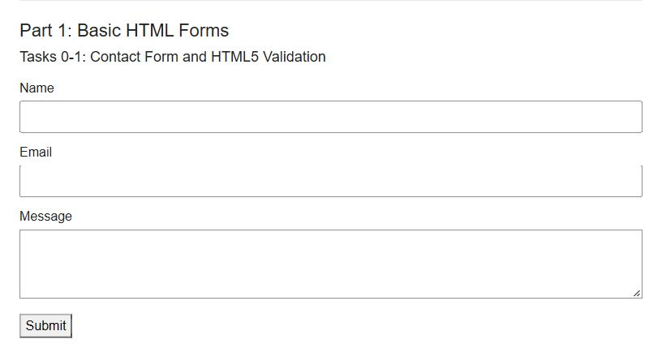
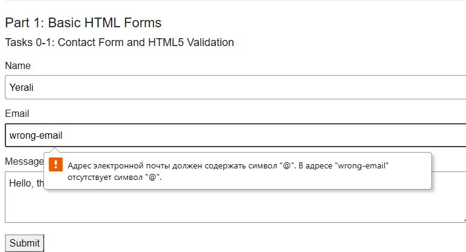
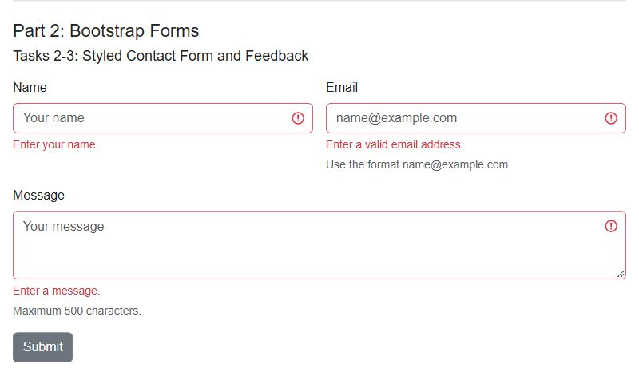
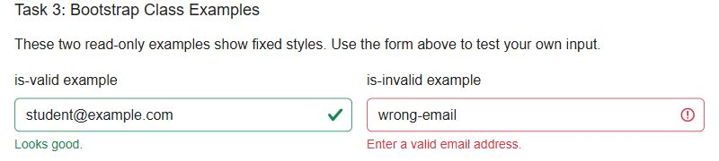
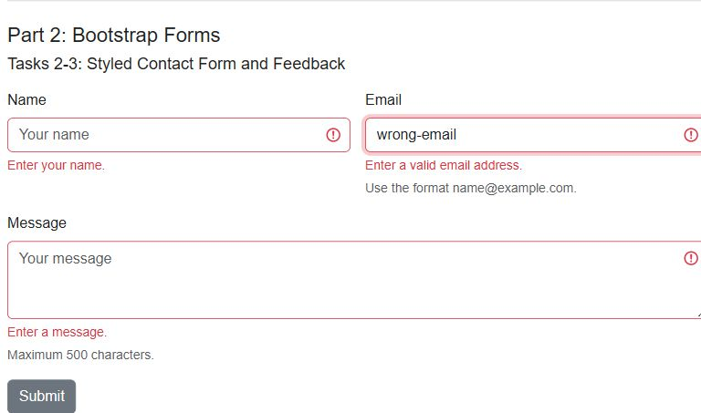
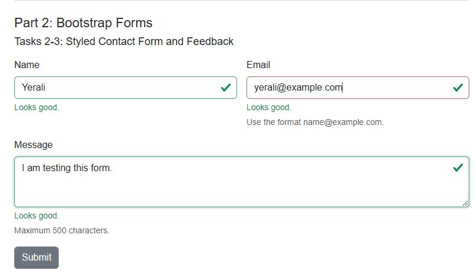
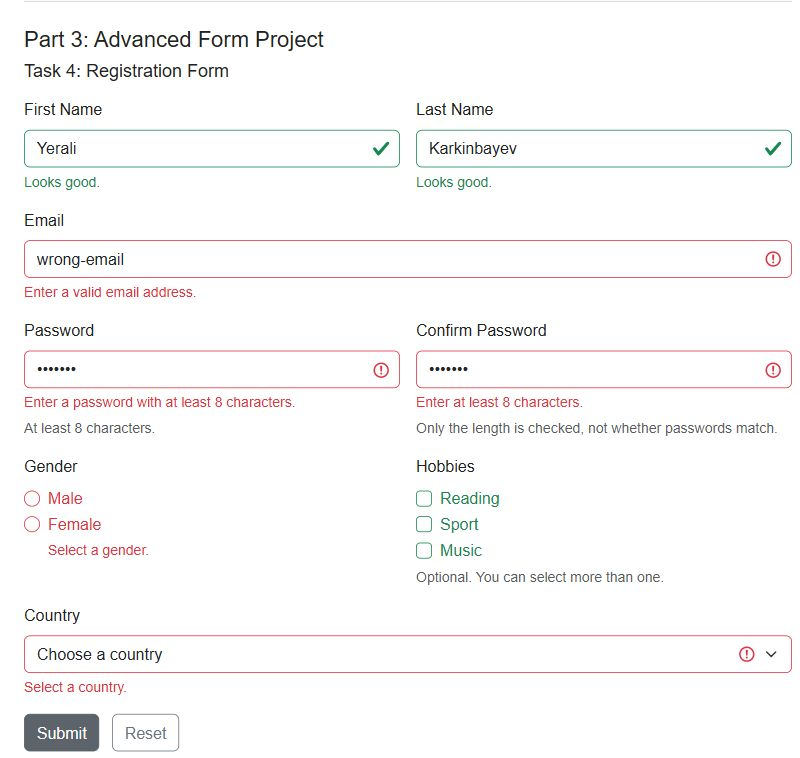
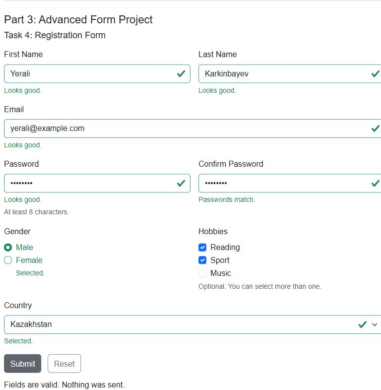
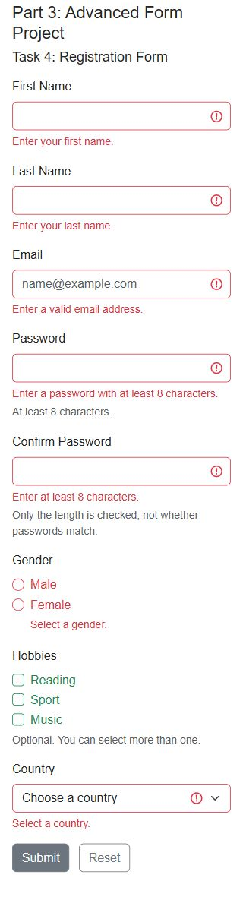

# Assignment 4: Forms and Validation

Name: Yerali Karkinbayev

Group: IT-2501

Three forms with HTML, CSS, Bootstrap and JavaScript. Open "index.html". Submit check the fields, nothing is sent.

## Part 1: Basic HTML Forms

### Task 0: Contact Form

Name, Email, Message and Submit. Labels use for and id.

### Task 1: HTML5 Validation

All fields is required. Email format is checked. Maximum length: name 50, email 100, message 500.

## Part 2: Bootstrap Forms

### Task 2: Bootstrap Contact Form

Bootstrap fields, placeholders and helper text. Grid gives two columns from 768px, one on phone.

### Task 3: Validation Classes

Bootstrap example. It checks validity on Submit and adds was-validated. Feedback then change with input.

Wrong input:

Correct input:

## Part 3: Advanced Form Project

### Task 4: Registration Form

Wrong input:

Correct input:

Phone:

First and last name, email, passwords, gender, hobbies and country. Both passwords need 8 or more characters, they are not compared. Hobbies are optional. Errors show after Submit. Reset clear fields, selections and validation styles.

## Work Process

I made forms then add Bootstrap and the validation script. Checked labels, empty fields, email, length limits, choices and Reset. Also tested at 320px, 768px and 1280px.
